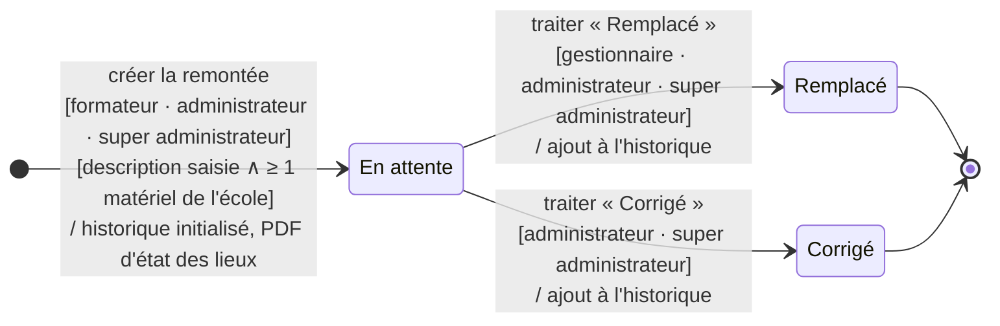
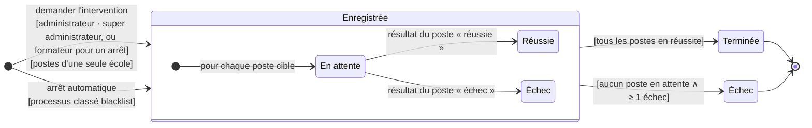

# Diagrammes d'états — brouillon V1

<!-- version:debut : généré par versions.py, ne pas modifier à la main -->
| Version | Mise à jour | Destination | Dernière évolution | Historique |
| --- | --- | --- | --- | --- |
| 1.0 | 09/11/2026 | Brouillon interne | Ajouter les diagrammes d'états de la remontée et des interventions | [1 version](../../archive/README.md#diagrammes-etats-brouillon-v1) |
<!-- version:fin -->

## Remontée

## Intervention sur les postes

